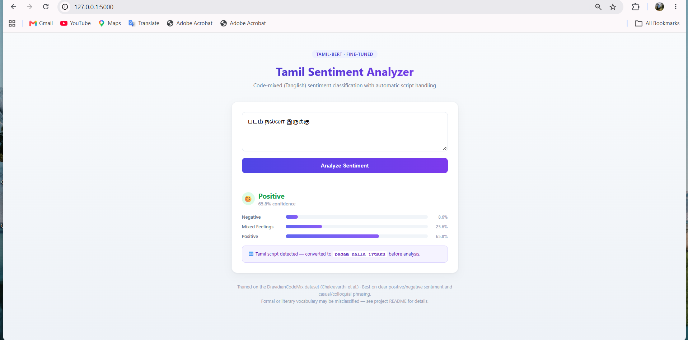

# Tamil Sentiment Analyzer

Sentiment classification for **Tamil–English code-mixed (Tanglish) YouTube comments**, built by fine-tuning Tamil-BERT, with a small Flask web demo that also accepts **Tamil-script input**.

The model labels a comment as **Positive**, **Negative** or **Mixed Feelings** and shows the confidence for each class.



---

## Highlights

- Fine-tuned `l3cube-pune/tamil-bert` on the DravidianCodeMix dataset: **70% accuracy, macro F1 0.56** on the held-out test set (~3.5K comments).
- Handled class imbalance with a **class-weighted loss**, without dropping or resampling data.
- Found and fixed a **script bias**: the training data is almost entirely Latin-script Tanglish, so Tamil-script input was misclassified (mostly as Positive). I built a rule-based **Tamil-script → casual Tanglish converter** that lifts accuracy on a Tamil-script test set from **47% to 67%** (see [Evaluation](#evaluation-on-tamil-script-input)).
- Documented where the model still fails, instead of hiding it (see [Limitations](#limitations)).

---

## Data

| | |
|---|---|
| Dataset | DravidianCodeMix (Chakravarthi et al.), Tamil–English code-mixed YouTube comments |
| Raw size | ~44K comments |
| After cleaning | ~27.7K train / ~3.5K dev / ~3.5K test |
| Cleaning | Dropped `unknown_state` and not-Tamil labels, and corrupted rows |
| Classes | Positive, Negative, Mixed Feelings |

The classes are imbalanced, which is why a weighted loss was used.

## Model and training

- **Base model:** `l3cube-pune/tamil-bert` (I first tried `ai4bharat/indic-bert`, but it became a gated repo on Hugging Face).
- **Imbalance:** class-weighted cross-entropy loss.
- **Training:** Google Colab, 8 epochs. I also tried 4 epochs and got essentially the same results, so the model had plateaued rather than being under-trained. I kept the 8-epoch model.

### Results on the held-out test set (~3.5K comments)

| Metric | Score |
|---|---|
| Accuracy | 70% |
| Macro F1 | 0.56 |
| Positive F1 | 0.83 |
| Negative F1 | ~0.51 |
| Mixed Feelings F1 | ~0.35 |

Mixed Feelings is the hardest class: it is small, and the label is subjective even for humans.

---

## The script-bias problem and the fix

**Problem.** The model was trained on comments written mostly in Latin letters ("padam romba mokka"). When I typed the same kind of comment in Tamil script (படம் ரொம்ப மொக்க), it was misclassified as Positive in 4 out of 4 initial tests.

**First attempt.** Transliterating Tamil script to Latin with the ITRANS scheme. This produced text like `bhadham ròmbha mòghgha`, which looks nothing like real Tanglish, so the model still saw noise and fell back to its majority class (Positive).

**Fix.** A rule-based converter (built into `app.py`) that writes Tamil the way people actually type it:

- plain consonants (`k`, `s`, `t`, `th`, `p`) instead of `gh`, `jh`, `dh`, `bh`;
- no diacritics;
- a small dictionary for English loanwords written in Tamil script (சூப்பர் → `super`, வேஸ்ட் → `waste`, டைம் → `time`);
- loanwords keep working with Tamil suffixes (சூப்பரா → `supera`).

Typing the same sentence by hand confirmed the diagnosis: `படம் ரொம்ப மொக்க, பணம் வேஸ்ட்` came out Positive (86.5%) through the old converter, but Negative (90.4%) through the new one, exactly matching the hand-typed `padam romba mokka, panam waste`.

## Evaluation on Tamil-script input

A small paired test set (`test_set.csv`) of **36 short movie-comment sentences, 12 per class**, each written in Tamil script and in typed Tanglish. `evaluate.py` runs the same sentences through the model four ways:

| Input to the model | Accuracy | Macro F1 |
|---|---|---|
| A. Typed Tanglish (best case) | 63.9% | 0.60 |
| **B. Tamil script → new converter** | **66.7%** | **0.65** |
| C. Tamil script → old ITRANS pipeline | 47.2% | 0.41 |
| D. Tamil script, no conversion | 50.0% | 0.43 |

What this shows:

- The new converter improves Tamil-script accuracy by about **19 percentage points** over the old ITRANS pipeline (24/36 vs 17/36 correct) and about 17 points over doing nothing.
- The old ITRANS pipeline was no better than sending raw Tamil script, so the conversion step was not helping until the converter was fixed.
- Converted Tamil script performs about the same as hand-typed Tanglish. B being 1 sentence ahead of A is noise, so I read it as "the converter reaches the typed-input level", not "better than typed".

**Caveat on size.** 36 sentences is small. Treat differences of 1–2 sentences as noise. These numbers come from a balanced set and are not directly comparable to the 70% / 0.56 on the full test set above. Reproduce with `py evaluate.py`.

---

## Limitations

- **Positive bias.** In all four conditions, every Positive sentence was classified correctly, but many Negative and Mixed sentences were also predicted Positive. When unsure, the model leans Positive.
- **Mixed Feelings is weak** (recall 25% typed, 42% with the converter on the small set; F1 ~0.35 on the full test set). Sentences with both praise and criticism are often assigned to one side.
- **Formal / literary Tamil.** Words like தரமற்றது or ஏமாற்றமளிக்கிறது are often classified as Positive, while casual phrasing of the same sentiment is classified correctly. This is a vocabulary and register gap in the training data, not a script problem, and it is not fixed.
- **Brittle on small changes.** For example, `pattu ellame arumaiya irukku` was predicted Negative (89%), while `pattu ellame super irukku` was Positive and `arumaiya` alone was Positive. Changing one word can flip the result.
- **Converter spelling.** The converter is rule-based. Spelling choices (for example `paattu` vs `pattu`) can change the model's confidence even when the meaning is the same.
- **Domain.** The training data is YouTube comments, mostly about films, so performance on other kinds of text (news, product reviews, formal writing) is unknown.

## Possible improvements

- Augment training data with Tamil-script versions of the Latin comments, so the model sees both scripts and needs no conversion at inference.
- Add more formal-register Tamil data to close the vocabulary gap.
- Build a larger Tamil-script test set, labelled by more than one person.

---

## Run it locally

Requirements: Python 3.10+ with `flask`, `torch` and `transformers`.

```bash
pip install flask torch transformers
```

Expected folder layout:

```
tamil_sentiment_app/
├── app.py
├── evaluate.py
├── test_set.csv
└── model/            # fine-tuned model files (see below)
    ├── config.json
    ├── tokenizer_config.json
    ├── tokenizer.json
    └── model.safetensors
```

The fine-tuned weights are not published yet, so the web app and evaluate.py need your own fine-tuned model in a model/ folder. The model was fine-tuned from l3cube-pune/tamil-bert on DravidianCodeMix (see “Model and training” above). -->

Start the web app:

```bash
python app.py        # on Windows: py app.py
```

Then open <http://127.0.0.1:5000>, type a Tamil or Tanglish comment and press **Analyze Sentiment**. If you type Tamil script, the page shows the converted text the model actually saw.

Re-run the evaluation (stop the web app first, since both load the model):

```bash
python evaluate.py
```

This prints the table above and saves every prediction to `eval_results.csv`.

---

## Credits

- Dataset: github.com/bharathichezhiyan/DravidianCodeMix-Dataset. <!-- Chakravarthi, B. R., Priyadharshini, R., Muralidaran, V., Jose, N., Suryawanshi, S., Sherly, E., & McCrae, J. P. (2022). Dravidiancodemix: Sentiment analysis and offensive language identification dataset for dravidian languages in code-mixed text. Language Resources and Evaluation, 56(3), 765-806. -->
- Base model: `l3cube-pune/tamil-bert` (L3Cube).
